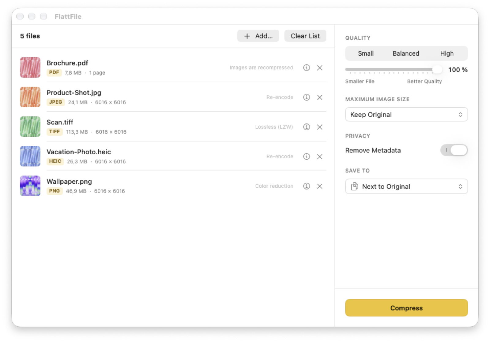

# FlattFile – Free PDF & Image Compressor for macOS

Compress PDFs and images and remove metadata on macOS. Supports PDF, JPEG, PNG, HEIC, TIFF, BMP and RAW via drag and drop. A free alternative to ImageOptim and PDF Squeezer.

**Build:** macOS 14+, Xcode Command Line Tools → `./build_app.sh`

Feedback and ideas are welcome – just open an [issue](../../issues).

MIT License © sami_i04

---
imageoptim alternative, pdf squeezer alternative, pdf compressor, image compressor, remove exif metadata, heic converter, file size reducer, swift, macos
